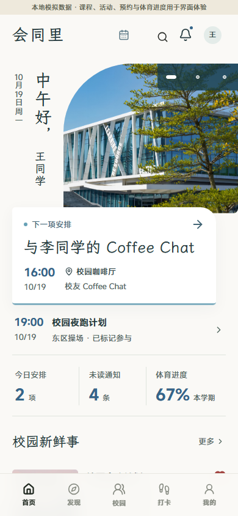
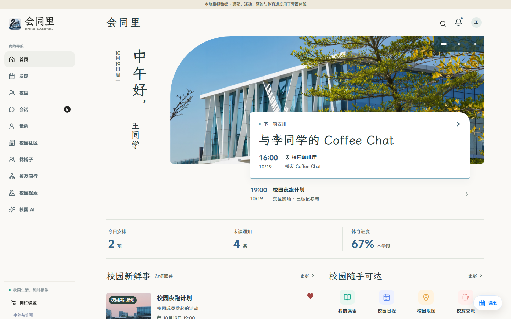

# 校园窗口 · 学生首页

2026-10-19，按用户确认将“校园窗口”接入学生首页 `/v2`。本地预览：http://127.0.0.1:4174/v2 。旧预览书签 `/v2/design/campus-window` 在开发环境跳转到首页。

沿用现有校园照片、MiSans 和霞鹜文楷，以及首页已有账号权限、接口读数、安排、收藏和关注规则。移除方案编号及对照入口，保留全局本地模拟数据提示。其他学生页面及业务逻辑沿用现状。

## 验证

- TypeScript 检查、三个相关源文件的 ESLint 均通过；首页及现有参考页面的组件测试 5 项通过。
- 浏览器验证 11 项通过，详见 [browser-report.json](browser-report.json)。涵盖真实安排入口、搜索、课表、收藏读回与失败状态、减少动态、空态及错误重试、登录保护、旧书签跳转和其他五个学生页面。
- 在 320、390、720、1440 像素宽度验证布局，无横向溢出，主要安排可见；已查看手机首屏截图。
- 验证使用本地验收数据。收藏测试恢复原有关系；空态和错误仅通过浏览器响应模拟。本记录不代表生产或真实设备验收。

复查命令（本地前后端服务须已启动）：

```powershell
python -X utf8 design/oil-ui-home/round-02/verify_preview.py --homepage
```

## 画面




