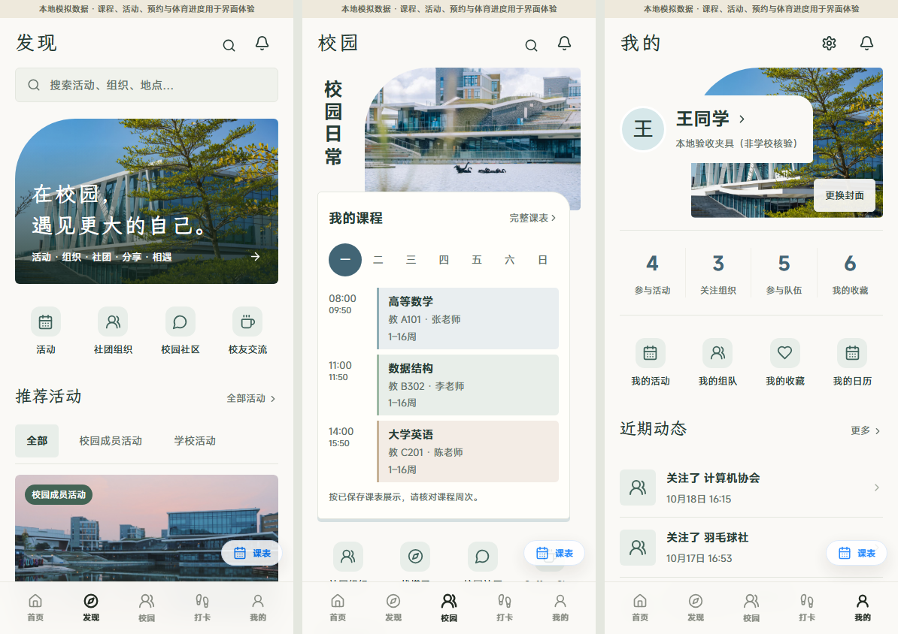

# 校园窗口 · 发现、校园与我的

2026-10-19。按用户确认，将已采用的校园窗口风格延伸至学生端发现、校园与我的页面。主要任务分别为寻找活动、访问课程与校园服务、查看本人记录及资料入口。

## 呈现

- 三页共享暖白、校园绿和蓝灰色，文楷用于页面及分区标题，MiSans 用于正文、数字和控件。照片全部来自现有校园资源。
- 发现页保留搜索、类别、时间地点排序、活动卡片及收藏，调整照片弧形裁切、卡片边界及筛选控件。
- 校园页以现有公共空间照片衔接课程卡片，统一服务入口、组织、社区与搭子区域。
- 我的页面保留本人背景偏好，使用照片窗口、独立资料区域和轻边框统计及功能列表。现有个人子页沿用同一页面标题与边框语法。
- 仅增加展示元素与局部样式作用域，数据读取、权限、事件处理和写入接口沿用现状。

## 本地验证

- TypeScript、修改源文件 ESLint 均通过，现有参考页面组件测试 5 项通过。
- 浏览器检查 17 项通过，详情见 [browser-report.json](browser-report.json)。320、390、720、1440 像素宽度均无横向溢出。
- 覆盖发现搜索、空结果与清除筛选、排序和活动详情；校园课程星期选择及完整课表；封面选择打开与取消、收藏列表入口；三页全局课表窗口。
- 主 Agent 查看三页手机和桌面截图，修复窄屏星期按钮溢出及紧凑社区照片尺寸。改前截图以 `baseline-` 前缀保留。
- 使用本地验收账号及模拟数据，浏览器未执行业务写入；未进行生产及真实设备验收。

前后端服务已启动时复查：

```powershell
python -X utf8 design/oil-ui-home/round-04/verify_pages.py
```

## 预览

- 发现：http://127.0.0.1:4174/v2/activities
- 校园：http://127.0.0.1:4174/v2/campus
- 我的：http://127.0.0.1:4174/v2/me


