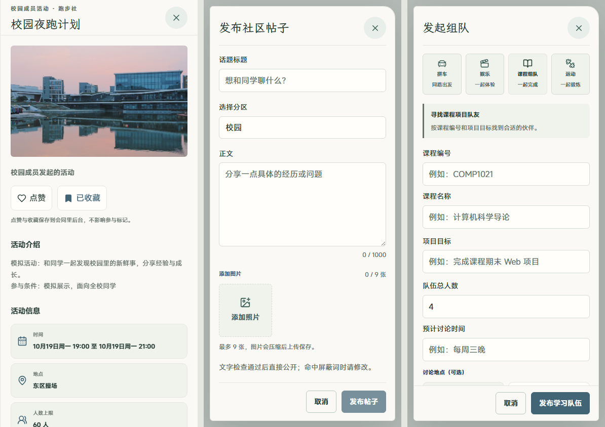

# 校园窗口 · 学生二级页面与弹层

2026-10-19，延续用户已选择的校园窗口风格。主要任务是从列表进入对象详情、筛选与查看个人安排，并在原有弹窗中填写或取消表单。

## 实现范围

- 新增学生端共享样式 `src/v2/reference/campusWindowDetails.css`，统一暖白底色、文楷页面和弹窗标题、MiSans 正文、蓝灰按钮、轻边框与现有照片的弧形裁切。
- 覆盖活动管理及详情、日程、组织、校园社区、搭子及队伍、Coffee Chat、校友、消息通知、AI、设置和个人子页。课表、发布、组队、图标及封面选择、侧栏设置、恢复确认等共用弹层继承同一视觉。
- 调整手机弹窗高度及滚动区域，标题和关闭按钮随内容滚动保持可见；修复组织列表与社区工具栏在窄屏下的溢出。
- 体育模拟卡片使用独立文档，因此仅同步其 CSS 色值、按钮与弹层边框。地图仅调整宿主工具栏、面板和选择弹层容器；模型与渲染规则沿用现状。
- 实际代码变更仅涉及 CSS、样式入口和本说明。事件处理、接口、权限、持久化和各业务流程沿用现状，原有模拟标识及状态含义保留。

## 验证与证据

- `npm run build` 通过；Vite 仍提示现有较大资源包与重复导入模块，未影响构建完成。TypeScript、入口文件 ESLint、参考页面及体育接入测试共 8 项通过。
- [browser-report.json](browser-report.json)：26 个路由，分别检查 390×844、1440×900、320×780、720×450 布局，均无横向溢出，未捕获页面异常。
- 7 个共用弹窗检查四种视口边界及 Escape 关闭：添加日程、社区发布、发起组队、课表导入、恢复确认、AI 图标和侧栏设置。另外查看课程详情抽屉、老师时段页与全局课表窗口。
- 验证独立体育模拟文档的主题色；通过浏览器响应模拟读取失败，检查错误可见且恢复后消失；分别登录本地教师和管理员验收账号，确认未应用学生端主题变量。
- 主 Agent 查看活动详情、发布和组队表单、交流、设置及课表窗口截图；`baseline-` 图片是在本轮样式接入前保留的参考画面。表单仅打开和取消，未提交发布、认证、预约、重置或真实体育操作。
- 以上为本地浏览器与验收数据检查，未进行生产及真实设备验收；未穷举各业务对象的全部权限和状态组合。

前后端启动后复查：

```powershell
python -X utf8 design/oil-ui-home/round-05/verify_details.py
```

## 本地预览

- 日程：http://127.0.0.1:4174/v2/schedule
- 活动详情：http://127.0.0.1:4174/v2/activities/preview-event-2
- 社区及发布弹窗：http://127.0.0.1:4174/v2/community
- Coffee Chat：http://127.0.0.1:4174/v2/coffee


