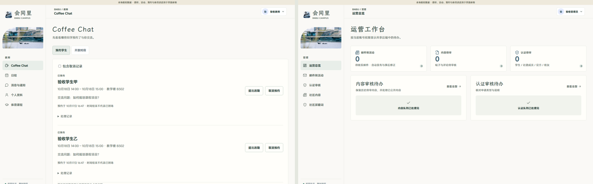

# 校园窗口 · 教师与管理员端

2026-10-19，按用户确认将已选定的校园窗口风格延伸至教师和管理员端。教师保留预约、日程与资料维护结构；管理员保留待办、筛选队列、审核详情与运营表单结构。

## 实现

- 新增 `campusWindowStaff.css`，以角色展示类限定样式；共用弹层通过当前角色容器继承暖白、校园绿和蓝灰色。
- 页面和分区标题使用已有霞鹜文楷，正文、数字与控件使用 MiSans；侧栏的校园窗口复用 `campus-services.jpg`，保留字体许可及原照片资源。
- 统一导航、面板、待办统计、筛选、表单、按钮、空态与弹窗。管理员统计在桌面三列、手机单列展示，教师时段表单在桌面两列、手机单列展示。
- 教师体育看板同步容器与统计面板样式，数据源未接通时保留原来的未知与错误提示。
- 代码仅新增样式入口、角色展示类和侧栏照片；原事件处理、权限、接口、数据与状态流程保持现状。

## 验证

- 生产构建、修改文件 ESLint 与参考页面组件测试 5 项通过。首次构建遇到 Windows 临时文件删除失败，使用本次进程的独立临时目录后通过；Vite 仍有现有资源包体积及模块重复导入提示。
- [browser-report.json](browser-report.json)：教师 5 个路由、管理员 5 个路由，在 1440×900、390×844、320×780、720×450 检查，均无横向溢出，未捕获页面异常。
- 检查教师预约与开放时段标签、时段表单、取消和改期弹窗；弹窗在四种视口下位于屏幕内，并可通过 Escape 关闭。
- 检查管理员已展示内容筛选与详情抽屉，以及两端手机导航打开和关闭。验收数据词库为空，因此未进行已有词汇编辑检查；各待审空队列保留真实空态。
- 主 Agent 查看教师预约、时段表单、取消弹窗，管理员总览、内容列表与抽屉，以及教师体育看板截图。`baseline-` 图片保留本轮改造前的画面。
- 使用本地验收账号；表单、改期、取消与审核仅打开和关闭，未提交任何业务决定。验证不代表生产或真实设备验收，未穷举所有权限及业务状态。

服务启动后复查：

```powershell
python -X utf8 design/oil-ui-home/round-06/verify_staff.py
```

## 已打开的本地预览

- 教师：http://localhost:4174/v2/teacher/coffee
- 管理员：http://127.0.0.1:4174/v2/admin

两个主机名使用同一套本地前后端与验收数据库，并分别保留教师和管理员会话，方便并排查看。


