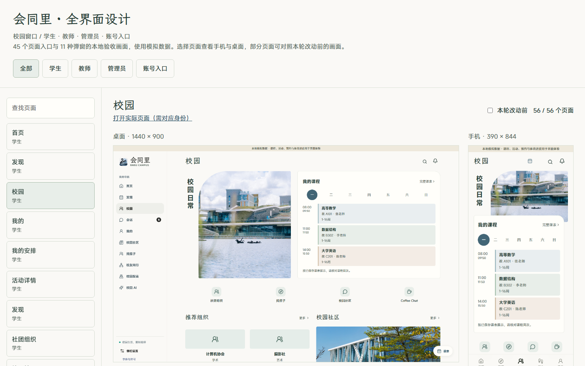

# 会同里 · Oil UI 逐页设计

2026-10-19。延续用户已确定的校园窗口方向，对当前 V2 三端和账号入口逐页梳理。目标是让用户一眼看清当前对象、下一项动作和已有状态，同时保留校园照片与文楷的识别度。

## 查看结果

打开 http://127.0.0.1:4174/design/oil-ui-home/round-07/index.html 。浏览页包括 **45 个页面入口与 11 种弹窗**，可按身份、页面名称筛选；每项均有桌面和手机画面，10 个代表入口可切换本轮改前对照。

这是本地验收画面的浏览页，使用现有模拟数据；“打开实际页面”进入原路由并要求对应身份。页面别名和原有重定向沿用现状，未新增业务页面。

- [逐页任务与布局清单](page-plan.md)
- [路由与视口检查](report.json)
- [弹窗目录](overlays.json)
- [独立评审及修正](review.md)

## 设计决定

- 保留已确认的学生首页构图。校园页将地点照片和课程并列，个人页将近期动态与日历并列；日程页采用日历与安排分栏。手机按原阅读顺序还原单列。
- 组织用名称和介绍连续排列；学生交流首屏优先露出具体教师。社区减少重复宣传和发布入口，保留当前内容及筛选。消息和 AI 使用连续工作区，设置将隐私与演示控制分组。
- 教师预约按单条记录组织原操作，管理员总览以队列为主，屏蔽词页面在桌面区分编辑区与词库。
- 登录、注册、密码找回与身份核验接入现有 MiSans、霞鹜文楷与校园照片，保留各自表单阶段与错误。关系网只调整绘制样式；内嵌地图新增宿主主题 CSS，不修改模型、图层、相机及地点数据。
- 去掉重复英文标记、重复照片宣传及多余发布入口，保留业务对象、状态、模拟与未知提示。不同任务沿用有效结构，没有将每个页面改成同一种卡片布局。

## 动效

沿用已有照片轮播与弹层出入效果；本轮增加按钮按下和筛选颜色变化的短反馈，不用动画触发业务成功。减少动态时禁用新增过渡。首页轮播手动切换、暂停与运行时减少动态继续通过已有验证。

## 本地验证

- 类型检查与修改文件 ESLint 通过。按本轮 Oil UI 指示，未运行生产构建或全量单元测试。
- 45 个入口分别检查 1440×900、390×844、320×780、720×450，未发现横向溢出或页面异常；保存了各入口手机、桌面截图及代表长页截图。
- [交互复查](interaction-report.json)：现有第 04、05、06 阶段脚本由主 Agent 重跑，输出放入 `.runtime/round07-validation/`，避免改写历史证据。阶段 05 曾因角色切换时主内容短暂卸载出现等待器异常；本轮包装脚本加入等待条件后连续通过 3 次，其余各通过 1 次。
- [首页交互](homepage-interaction-report.json)：11 项通过，包括真实安排入口、收藏写入后重新读取、模拟失败后状态保留与原验收关系恢复。未对其他业务对象执行发布、预约、审核或重置。
- [新增状态与控件](states-report.json)：9 项通过，包括登录空字段错误、注册密码阶段、课表与顶栏控件在三种宽度下避让、社区单一可见发布入口。注册阶段仅填写本地测试内容并前进，未发送邮件、创建账号或设置密码。
- [最终局部检查](final-checks.json)：校友取消原因输入框触控高度、内嵌地图主题加载、浏览页 56 项与身份筛选通过。另检查浏览页搜索、改前图片和手机布局。
- 11 种弹窗只打开、查看并关闭，桌面与手机截图均已保存。没有提交业务决定。
- 1 轮独立视觉评审，不打分；主 Agent 修正并自查，详见评审记录。全部验证基于本地浏览器与验收数据，不代表生产或真实设备验收，也未穷举所有权限与业务状态。

## 复查命令

前后端服务须已运行：

```powershell
python -X utf8 design/oil-ui-home/round-07/capture_pages.py
python -X utf8 design/oil-ui-home/round-07/capture_overlays.py
python -X utf8 design/oil-ui-home/round-07/verify_states.py
python -X utf8 design/oil-ui-home/round-07/verify_existing.py
python -X utf8 design/oil-ui-home/round-07/build_gallery.py
```

截图文件保留在本目录。浏览页的图片可点开按原始尺寸查看；截图拼版用于查漏，不能替代实际阅读尺寸的检查。


